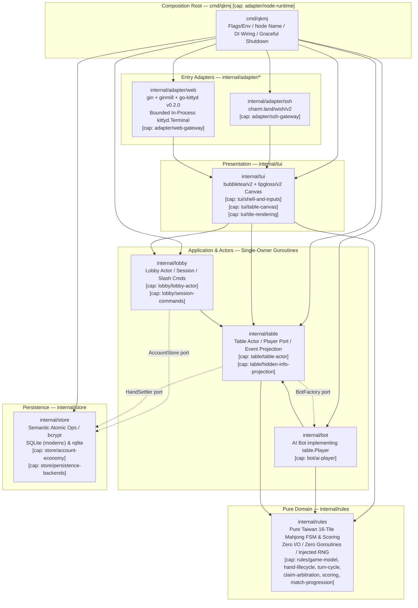
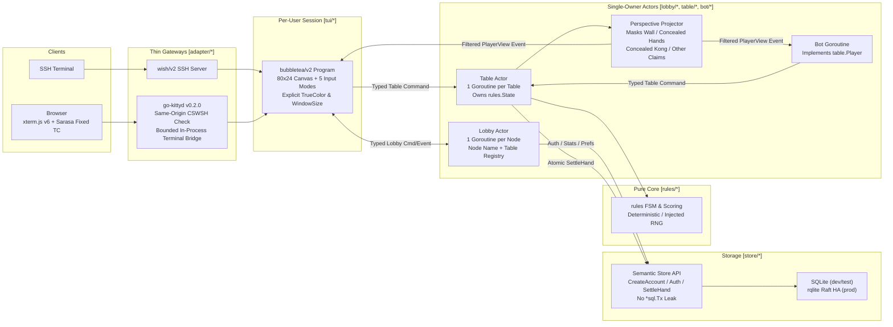

# architecture Specification

## Purpose

定義 `go-qkmj` 的真實程式開發架構總綱：以統一的 Go 套件分層（`cmd/qkmj` 與 `internal/*`）、單向依賴規則、執行期並發拓撲與公平性隔離邊界，串聯全專案 7 大雙層 Capability Domains（`rules/*`、`store/*`、`table/*`、`bot/*`、`lobby/*`、`tui/*`、`adapter/*`），確保所有領域規格在平行演進時維持零循環依賴、高測試性與一致的系統不變量。

### 系統靜態分層與 Capability Domain 映射圖

實線表示允許的 Go compile-time `import` 方向；虛線表示由 Composition Root（`cmd/qkmj`）透過 Consumer-Side Port 介面注入之依賴：

### 執行期並發拓撲與公平性邊界圖

展示 SSH 與 Web 雙入口如何在同一進程內驅動相同的 `bubbletea/v2` TUI，以及真人玩家與 AI 機器人如何透過完全對稱的 `table.Player` 介面與視角過濾投影層互動：

### Capability Domain 邊界總表

| Domain | 規劃之雙層 Capability IDs | 對應 Go Package | 職責邊界 | `../qkmj` 唯讀參考對應 |
|---|---|---|---|---|
| **總綱** | `architecture` | 全專案 | 套件分層、依賴禁令、並發拓撲、公平性、儲存與安全不變量 | （`go-qkmj` 原生） |
| **規則域** | `rules/game-model`、`rules/hand-lifecycle`、`rules/turn-cycle`、`rules/claim-arbitration`、`rules/scoring`、`rules/match-progression` | `internal/rules` | 台灣 16 張麻將純資料模型、純狀態機、胡牌拆解與台數計算 | `qkmj-rules/*`（扣除持久化） |
| **儲存域** | `store/account-economy`、`store/persistence-backends` | `internal/store` | 語意化原子帳號/經濟/排行/偏好操作與 SQLite / rqlite 後端 | `qkmj-rules/economy`、`qkmj-ux/preferences`（持久化） |
| **牌桌域** | `table/table-actor`、`table/hidden-info-projection` | `internal/table` | Single-Owner Table Actor、統一 `Player` 埠、視角過濾事件投影、計時與結算觸發 | `qkmj-ux/session`（牌桌）、`qkmj-rules/game-model`（可見性） |
| **機器人域** | `bot/ai-player` | `internal/bot` | 實作 `table.Player` 之 AI 玩家／補位代打，零牌桌內部存取 | （`go-qkmj` 原生） |
| **大廳域** | `lobby/lobby-actor`、`lobby/session-commands` | `internal/lobby` | Single-Owner Lobby Actor、登入會話、開桌進出、聊天、斜線指令與 Node Name | `qkmj-ux/session`（連線/大廳/指令） |
| **介面域** | `tui/shell-and-inputs`、`tui/table-canvas`、`tui/tile-rendering` | `internal/tui` | Charm v2 Server-Side TUI、五種單焦點輸入模式、80×24 畫布、全形文字牌與對齊 | `qkmj-ux/*`（除環境部署面） |
| **入口域** | `adapter/ssh-gateway`、`adapter/web-gateway`、`adapter/node-runtime` | `internal/adapter/ssh`、`internal/adapter/web`、`cmd/qkmj` | SSH (`wish/v2`)、Web (`gin` + `ginmill` + `go-kittyd`) 橋接與程式組裝/關機 | `qkmj-ux/terminal-environment` |

## ADDED Requirements

### Requirement: 雙層 Capability Domain 規格邊界與套件映射
系統 SHALL 以雙層 `<domain>/<capability>`（`rules/*`、`store/*`、`table/*`、`bot/*`、`lobby/*`、`tui/*`、`adapter/*`）作為各領域規格的邊界，並與對應的真實 Go package 維持明確歸屬關係；頂層 `architecture` 規格 SHALL 作為所有領域規格之總綱與跨層契約。系統 MUST NOT 將 `../qkmj` 參考規格整批未經設計地複製進 `openspec/specs/`。

#### Scenario: 新增領域能力提案時對齊總綱邊界
- **WHEN** 開發者為 `go-qkmj` 新增任一功能提案（例如 `rules/scoring` 或 `table/table-actor`）
- **THEN** 該規格 SHALL 置於對應的雙層路徑 `openspec/specs/<domain>/<capability>/spec.md`，且其對應的實作套件與依賴方向不得違反 `architecture` 總綱定義之分層規則

#### Scenario: 參考上游原版規格時的邊界處理
- **WHEN** 設計 `rules/*` 或 `tui/*` 領域規格並參考 `../qkmj` 既有文件
- **THEN** `../qkmj` 僅作為唯讀規格參考來源，系統僅就實際規劃與實作的能力撰寫 `go-qkmj` 自身規格，並針對原生 UTF-8 與 Server-Side TUI 調整介面契約

### Requirement: 嚴格單向分層與核心規則純粹性
系統 SHALL 強制執行由上而下的單向 Go package 依賴結構，並以 `cmd/qkmj` 作為唯一 Composition Root 組裝各層元件；`internal/adapter/ssh` 與 `internal/adapter/web` MUST 僅作為薄終端機／PTY 閘道層。`internal/rules` MUST 僅包含純函式與純狀態機，MUST NOT 使用 goroutine、channel、I/O、全域可變狀態、系統時鐘或全域亂數，洗牌與隨機行為 MUST 接受注入之 `rand.Source`。

#### Scenario: 規則引擎純粹性與決定性重播
- **WHEN** 測試或牌桌以相同的初始牌局狀態、相同的注入 `rand.Source` 種子與相同的玩家指令序列呼叫 `internal/rules`
- **THEN** `internal/rules` 必產生完全一致的狀態轉換與輸出結果，且不觸發任何 I/O、系統時間讀取或背景 goroutine

### Requirement: 核心 Actor 與介面層邊界隔離
`internal/table` 與 `internal/lobby` MUST 透過明確依賴注入取得外部埠介面，MUST NOT 宣告套件層級單例（例如 `GlobalLobby`），且 MUST NOT 匯入 `gin`、`ginmill`、`go-kittyd`、`wish` 或 `bubbletea`。`internal/tui` MUST 僅透過強型別 `Command` 與視角過濾 `Event` 與核心層通訊，MUST NOT 使用 `map[string]string` 作為跨層訊框載荷，且 MUST NOT 直接匯入 `internal/store`。

#### Scenario: 核心 Actor 與傳輸框架解耦
- **WHEN** 檢視 `internal/table` 與 `internal/lobby` 的 Go import 依賴圖
- **THEN** 兩者皆不直接或間接依賴任何 HTTP、WebSocket、SSH 或 TUI 框架套件，且所有外部儲存與機器人工廠皆透過 Consumer-Side 介面注入

#### Scenario: TUI 與核心層強型別通訊
- **WHEN** 玩家於 TUI 執行登入、開桌、出牌或宣告操作
- **THEN** `internal/tui` 僅能送出強型別指令並接收強型別事件，所有帳號驗證與戰績查詢皆經由 `internal/lobby` 處理而非繞過存取 `internal/store`

### Requirement: 單一擁有者 Actor 並發模型與優雅關機
系統 SHALL 為每個節點的大廳與每張牌桌採用 Single-Owner Actor 模型（各自擁有單一狀態維護 goroutine 與明確擁有權之輸入 channel），避免跨 goroutine 共享可變牌局狀態。Actor 向外部訂閱者派發事件時 MUST 使用有界佇列與慢消費者隔離策略，確保單一停滯連線不會阻塞 Actor 事件迴圈；系統停止時 MUST 依序執行 Graceful Shutdown 並釋放所有 goroutine 與資源。

#### Scenario: 單一慢速玩家不影響同桌 Actor 進度
- **WHEN** 牌桌中某一位玩家的事件接收端因網路擁塞而持續無法消化事件且超出有界緩衝上限
- **THEN** `Table Actor` SHALL 觸發該慢消費者的斷線或降級清理流程，其餘三位玩家與牌桌狀態機迴圈維持正常推進且不發生死鎖

#### Scenario: 伺服器收到終止訊號時優雅關機
- **WHEN** `cmd/qkmj` 收到 `SIGINT` 或 `SIGTERM`
- **THEN** 系統 SHALL 停止接受新 SSH/Web 連線、依序關閉進行中會話與 Actor goroutine、確保已提交結算落盤後正常結束進程，不遺留洩漏之 goroutine

### Requirement: 公平性與隱藏資訊隔離（統一 Player 介面）
系統 SHALL 透過統一的 `table.Player` 介面抽象所有牌桌參與者（包含真人桌長、真人成員與 `internal/bot` AI 機器人）。`Table Actor` 在規則允許揭露前，MUST 透過視角過濾投影（Perspective Projector）確保任何投遞給個別 `Player` 的事件絕不包含牌牆順序、他家未公開手牌、他家暗槓牌面或他家宣告選項；`internal/bot` MUST 僅透過該公開介面與強型別指令互動，不得存取 `Table` 內部狀態。

#### Scenario: 牌局進行中投遞事件至一般玩家與桌長
- **WHEN** 某家摸牌、暗槓或進入吃碰槓胡宣告視窗，`Table Actor` 向四位玩家廣播狀態事件
- **THEN** 每位玩家（含桌長）僅收到屬於自己視角的合法公開資訊與自身可選動作，事件載荷中不包含牌牆剩餘順序、他家暗手牌面、他家暗槓牌面與他家宣告選項

#### Scenario: AI 機器人與真人玩家共用相同資訊邊界
- **WHEN** `internal/bot` 透過注入之 `BotFactory` 加入牌桌並於輪到自己時做出出牌或宣告決策
- **THEN** AI 機器人僅能依據經由 `table.Player` 收到的過濾後事件做出決策並回傳強型別 `Command`，在編譯期即無法存取 `internal/table` 未匯出狀態或 `rules.State` 完整牌牆

### Requirement: 雙入口統一 Server-Side TUI 與 Bounded In-Process 終端橋接
系統 SHALL 同時提供 SSH（`internal/adapter/ssh` 搭配 `charm.land/wish/v2`）與 Web（`internal/adapter/web` 搭配 `gin`、`ginmill` 與 `go-kittyd`）兩種終端機入口，且兩者 MUST 於同一進程內驅動相同的 `internal/tui`（`bubbletea/v2` + `lipgloss/v2` Canvas）程式，MUST NOT 以 `os/exec` 為連線使用者派生子行程。Web 入口的 In-Process `kittyd.Terminal` 橋接實作 MUST 具備有界輸出緩衝、顯式色彩設定與初始尺寸注入、協調式雙向關閉、Resize 啟動時序保護以及單一會話 Panic 隔離。

#### Scenario: SSH 與 Web 玩家共享相同 TUI 邏輯與牌桌互動
- **WHEN** 一位玩家透過 SSH 連線，另一位玩家透過瀏覽器（`go-kittyd` + `xterm.js` + `Sarasa Fixed TC`）連線並加入同一張牌桌
- **THEN** 兩位玩家皆由同進程內各自的 `bubbletea/v2` 實例渲染一致的 80×24 牌桌介面並即時互動，且系統未產生任何外部子行程

#### Scenario: Web 終端橋接面對非 TTY、首次 Resize 與雙向斷線
- **WHEN** 瀏覽器建立 WebSocket 連線並立即送出初始 `resize` 控制訊息，隨後任一端（瀏覽器斷線或玩家執行 `/quit`）結束會話
- **THEN** Web 橋接層 SHALL 以 TrueColor 與最新終端尺寸正確驅動 `bubbletea/v2`，且任一端關閉時雙向 pipe 與程式上下文皆於單次協調 teardown 中乾淨釋放，不發生阻塞或 goroutine 洩漏

#### Scenario: 慢速瀏覽器連線觸發有界輸出背壓清理
- **WHEN** 瀏覽器端網路擁塞或半開斷線導致 WebSocket 寫入停滯，使 Web 終端橋接層的有界輸出緩衝達到上限
- **THEN** 橋接層 SHALL 主動終止該停滯會話並觸發離桌清理，絕不讓 `bubbletea/v2` 渲染迴圈永久阻塞或反壓影響同桌其他玩家

#### Scenario: 單一 TUI 會話發生未預期 Panic 時不影響其他連線
- **WHEN** 某位使用者的 TUI 會話在 `Update` 或 `View` 處理中發生未預期 panic
- **THEN** 會話外層恢復機制 SHALL 攔截該 panic、記錄結構化錯誤並執行該使用者的離桌清理，伺服器進程與其他在線牌桌維持正常運作

### Requirement: 原生 UTF-8 終端呈現與顯示寬度對齊
系統 SHALL 以原生 UTF-8 全形繁體中文文字牌（例如「一萬」、「紅中」、「東風」）搭配 Unicode 框線與方塊字元（如牌背 `█▉` 與 `▇▇▇▇`）作為預設牌面呈現，MUST NOT 將 `U+1F000+` Unicode 麻將表情符號作為預設牌面。所有欄位排版與游標定位計算 MUST 依據字元顯示寬度（display width / grapheme width），MUST NOT 以位元組長度計算欄寬。

#### Scenario: 跨終端機全形文字牌與框線對齊
- **WHEN** TUI 在標準 UTF-8 SSH 終端機或內嵌 `Sarasa Fixed TC` 的瀏覽器終端機繪製 80×24 牌桌畫面
- **THEN** 每張全形文字牌與框線皆依顯示寬度精確對齊，不因 UTF-8 多位元組長度造成欄位錯位

### Requirement: 水平擴展節點識別與語意化原子儲存邊界
系統 SHALL 支援每個節點獨立運行各自的 `Lobby Actor` 與 `Table Actor`，並為每個節點產生 Docker 風格之隨機 Node Name 呈現於介面（且可由環境變數或命令列旗標覆寫）。`internal/store` MUST 僅對外提供語意化原子操作（例如 `CreateAccount`、`Authenticate`、`SettleHand`），MUST NOT 將 `*sql.Tx` 洩漏至業務層，並同時支援純 Go SQLite（`modernc.org/sqlite`，用於本地開發與測試）與 `rqlite`（用於 1 至 3 節點 Raft 高可用正式環境），且 MUST NOT 執行高頻率資料庫心跳寫入。

#### Scenario: 局末四家分數結算保持原子性與後端無關
- **WHEN** 一局麻將結束並呼叫 `HandSettler.SettleHand` 結算四家加減分與局數統計
- **THEN** `internal/store` SHALL 在單一語意原子交易／批次內完成所有帳號更新，且呼叫端 `internal/table` 無須接觸 `*sql.Tx` 或感知底層為 SQLite 或 `rqlite`

#### Scenario: 節點啟動時顯示節點名稱並支援覆寫
- **WHEN** 節點於未指定節點名稱旗標時啟動，或於指定環境變數／旗標後啟動
- **THEN** 未指定時系統自動產生可讀的 Docker 風格隨機 Node Name 並於大廳介面顯示；指定時則採用設定值覆寫

### Requirement: 安全基線與外部輸入邊界驗證
系統 SHALL 於所有系統邊界驗證外部輸入（帳號名稱、密碼、聊天訊息、斜線指令、終端控制尺寸），並強制遵守以下安全基線：密碼 MUST 使用 `bcrypt`（cost >= 12）雜湊保存；資料庫存取 MUST 僅使用參數化查詢且禁止拼接 SQL 字串；系統 MUST NOT 將任何使用者輸入傳遞至 `os/exec`；Web 終端機 WebSocket 入口 MUST 預設啟用同源（Same-Origin）CSWSH 防護。

#### Scenario: 跨站 WebSocket 升級與非法輸入被邊界攔截
- **WHEN** 跨來源網頁嘗試升級 `/ws` 連線，或使用者於登入／斜線指令送入超長或含惡意字元之輸入
- **THEN** Web 閘道層 SHALL 預設拒絕跨來源升級（`403 Forbidden`），且邊界驗證器 SHALL 拒絕不合法輸入而不影響內部 Actor 或資料庫完整性
