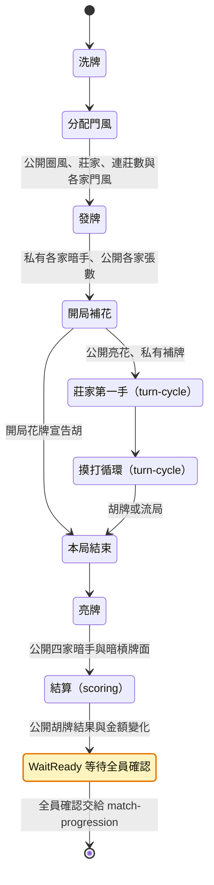
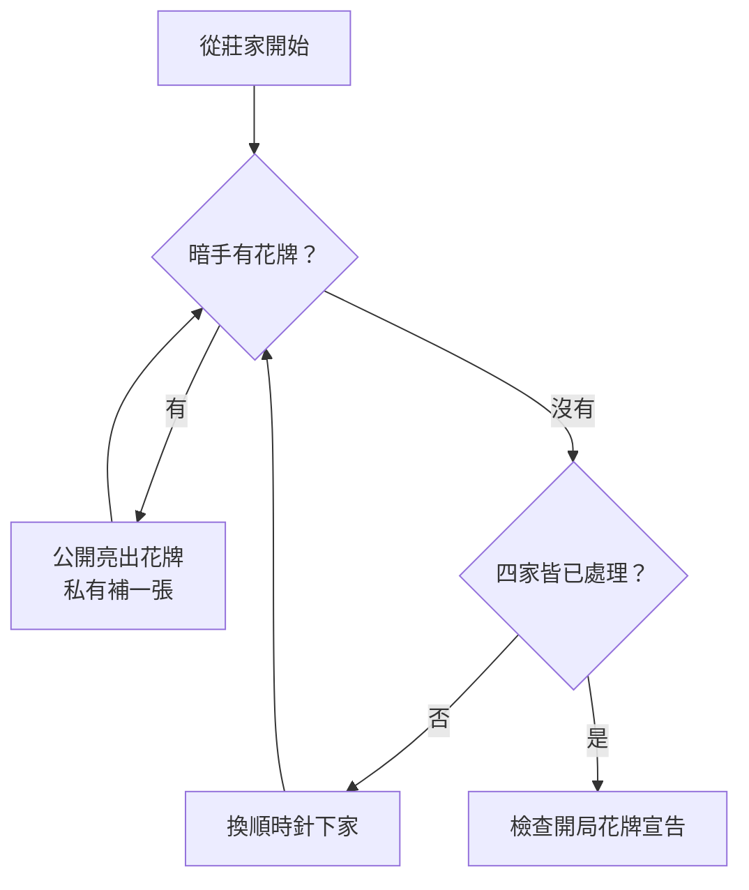

# rules/hand-lifecycle Specification

## Purpose

定義 `internal/rules` 單局完整生命週期純狀態機（`HandEngine`）：從洗牌、隨機開門分配門風、發牌、開局補花、開局花牌宣告、莊家第一手，銜接 `rules/turn-cycle` 摸打循環，至胡牌或流局後亮四家暗手與暗槓、依 `rules/scoring` 結算並進入全員確認 `WaitReady`，以及中途有人離開時立即作廢中止。

## ADDED Requirements

### Requirement: 一局的開始順序
每局啟動時，系統 SHALL 依序自動完成洗牌（見 `rules/game-model`）、分配門風、發牌、開局補花，再銜接開局花牌宣告或莊家第一手；開局自動化流程期間玩家 MUST NOT 需要送出任何動作。

#### Scenario: 自動完成開局準備
- **WHEN** 系統啟動新的一局
- **THEN** 單次啟動即依序產出門風、發牌與開局補花事件，並直接停在開局花牌宣告視窗或莊家第一手等待狀態

### Requirement: 隨機開門分配門風
每局開始時，系統 SHALL 透過注入式亂數均勻隨機選出一位「開門」座位（四家機率相同）：該座位門風為東，依順時針輪轉其後三家依序為南、西、北，並於發牌前公開。門風與莊家無關，連莊時亦須重新隨機決定。

#### Scenario: 3 號座位開門決定四家門風
- **WHEN** 本局莊家為 1 號座位、隨機開門座位為 3 號座位
- **THEN** 公開之各家門風為 3 號東、4 號南、1 號西、2 號北，不受莊家為 1 號影響

#### Scenario: 連莊開新局重新決定門風
- **WHEN** 莊家連莊進入下一局
- **THEN** 系統重新呼叫注入式亂數決定開門座位，不沿用上一局的門風配置

### Requirement: 發牌與隱藏資訊隔離
系統 SHALL 自牌牆發給每家 16 張、莊家多發 1 張共 17 張（共 65 張，可摸張數餘 63 張）。每位玩家僅透過私有事件收到自己的暗手，公開事件 MUST 只包含各家張數與剩餘可摸張數，絕不洩露他家手牌或牌牆順序。

#### Scenario: 發牌後公私事件嚴格分離
- **WHEN** 1 號座位做莊完成發牌
- **THEN** 公開事件顯示 1 號 17 張、2 至 4 號各 16 張且可摸張數為 63；各座位私有事件僅含該座位自身暗手

### Requirement: 開局補花
發牌後，系統 SHALL 從莊家起依順時針輪轉，替每家將暗手花牌全數亮出並各補一張；若補到又是花牌則持續亮出再補，直到該家無花牌才換下一家。亮花為公開事件、補牌牌面為私有事件；開局補花期間 MUST NOT 開啟花牌宣告視窗。

#### Scenario: 開局連補到花牌持續補至非花
- **WHEN** 開局時莊家暗手含春１，補牌摸到菊３，再補牌摸到五萬
- **THEN** 春１與菊３依序公開亮出，五萬私下交付莊家，直到莊家暗手無花才輪到下家補花

### Requirement: 開局後的花牌宣告
四家開局補花全數完成後，若有單家持有 8 張花或一家 7 張且另一家 1 張，系統 SHALL 依 `rules/claim-arbitration` 開啟一次花牌宣告視窗詢問八仙過海或七搶一；宣告成立時本局直接以胡牌結束，不進入莊家第一手；放棄則繼續進入莊家第一手。

#### Scenario: 開局集滿八張花宣告八仙過海
- **WHEN** 四家開局補花完畢後 2 號座位持有全部 8 張花，且 2 號宣告胡
- **THEN** 本局直接以 2 號八仙過海胡牌結束並進入亮牌與結算，不進入莊家第一手

### Requirement: 莊家第一手
開局補花完成且無花牌宣告成立時，莊家 SHALL 不摸牌直接以手上 17 張進入 `rules/turn-cycle` 自身宣告（可宣告天胡自摸或暗槓）；無可宣告項目時直接進入 `WaitDiscard` 等待莊家出牌。

#### Scenario: 莊家起手 17 張即可胡
- **WHEN** 莊家開局補花後的 17 張已構成胡牌型
- **THEN** 系統私下詢問莊家自摸選項，宣告自摸時依 `rules/scoring` 計入天胡

#### Scenario: 莊家起手無自身選項直接等待出牌
- **WHEN** 莊家開局補花後的 17 張不可自摸亦無暗槓
- **THEN** 系統直接進入 `WaitDiscard` 等待莊家出牌，不經過摸牌階段

### Requirement: 一局的結束方式
一局 SHALL 僅能以下列三種方式之一結束：胡牌（自摸、放槍、搶槓、七搶一、八仙過海）、流局（見 `rules/turn-cycle`），或有人離開而中止（見 `rules/match-progression`）。每局最多僅有一位胡牌者。

#### Scenario: 胡牌結束後不再接受摸打動作
- **WHEN** 本局已有玩家胡牌成立並完成結算進入等待確認
- **THEN** 本局僅記錄該單一胡牌者，且後續摸牌或出牌動作皆被拒絕

### Requirement: 胡牌與流局亮牌
本局以胡牌或流局結束時，系統 SHALL 公開四家完整暗手與已宣告之暗槓牌面；若因有人離開而中止，系統 MUST NOT 亮出任何暗手或暗槓牌面。

#### Scenario: 流局時公開四家暗手與暗槓牌面
- **WHEN** 本局海底流局且 2 號座位曾宣告一組暗槓
- **THEN** 公開亮牌事件包含四家暗手以及 2 號該組暗槓之實際牌面

#### Scenario: 中途有人離開中止不亮牌
- **WHEN** 摸打進行中因 3 號座位離開而中止本局
- **THEN** 系統不發出亮牌事件，各家暗手與暗槓牌面皆不公開

### Requirement: 結算與金額變動輸出
亮牌後，若以胡牌結束，系統 SHALL 依 `rules/scoring` 公開胡牌結果（胡牌者、型態、支付者、台型明細與總台數）與每家餘額變化（原金額、變動、新金額），並標記四家皆計入已玩局數；流局時所有座位金額變動為 0 且不計入已玩局數。

#### Scenario: 放槍胡牌結算輸出四家餘額變化
- **WHEN** 2 號座位胡 4 號座位打出之牌，2 號贏得 1500
- **THEN** 公開結算事件顯示 2 號 +1500、4 號 -1500、1 號與 3 號變動 0，並標記計入已玩局數

#### Scenario: 流局結算零金額變動
- **WHEN** 本局流局完成亮牌
- **THEN** 公開結算事件中四家金額變動皆為 0、胡牌結果為空，且不計入已玩局數

### Requirement: 等待全員確認
結算或流局公開後，系統 SHALL 進入 `WaitReady`：同桌四位座位皆送出 `ActionReady` 後本局才視為完成並交回 `rules/match-progression`。等待期間 MUST 拒絕非確認動作與重複確認；流局亦須等待全部四人確認，不得僅等開桌者。

#### Scenario: 流局同樣須等待四家皆確認
- **WHEN** 本局流局進入 `WaitReady`，僅 1、2、3 號座位送出確認而 4 號尚未確認
- **THEN** 本局仍停留於 `WaitReady`，直到 4 號送出確認後才完成本局

#### Scenario: 等待確認期間拒絕出牌與重複確認
- **WHEN** 處於 `WaitReady` 時 1 號座位重複送出確認，或 2 號座位送出出牌動作
- **THEN** 兩者皆回傳錯誤且不改變確認狀態
