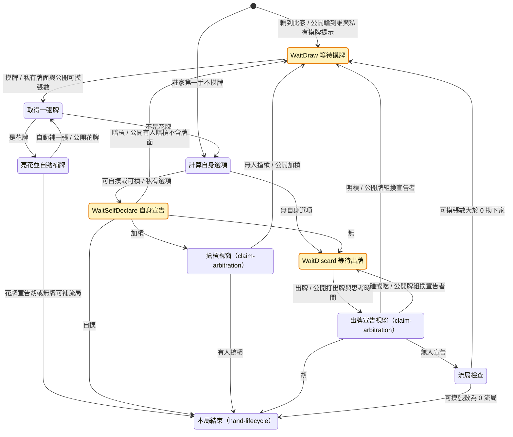

# rules/turn-cycle Specification

## Purpose

定義 `internal/rules` 單局內的回合狀態機：等待摸牌、摸牌與自動補花、全手自身選項（自摸、暗槓、加槓）、搶槓轉移、等待出牌、宣告結果座位轉移、可摸張數為 0 僅能胡與海底流局，以及由外部注入耗時之累計思考時間。

## ADDED Requirements

### Requirement: 等待摸牌與槓後手動補牌
輪到某家摸牌（上一家出牌無人宣告，或該家剛完成暗槓、明槓、加槓須補牌）時，系統 SHALL 公開輪到誰、私下提示該家摸牌並進入 `WaitDraw`，僅接受該家送出摸牌動作。

#### Scenario: 暗槓後進入等待摸牌補牌
- **WHEN** 玩家在自己回合完成暗槓
- **THEN** 系統不自動發補牌，而是讓該家進入 `WaitDraw` 等待送出摸牌，且補進之牌標記為補牌供杠上開花判定

### Requirement: 摸牌與自動連續補花
該家送出摸牌後，系統 SHALL 自可摸牌牆取一張牌私下交付該家，並公開誰摸牌與新可摸張數。摸到或補到花牌時，系統 SHALL 公開亮出花牌、先檢查花牌宣告視窗（8 張或 7+1），無人宣告後自動補一張牌直到補到非花牌；若此時可摸張數已為 0 無法補牌，SHALL 直接以流局結束，絕不動用 16 張保留牌。

#### Scenario: 摸到連續花牌自動補花
- **WHEN** 玩家摸到梅１後自動補到竹４，再自動補到五萬
- **THEN** 梅１與竹４依序公開亮出，五萬私下交付該家，可摸張數共減少 3 張

#### Scenario: 最後一張可摸牌為花牌時保護保留牌
- **WHEN** 可摸張數為 1，玩家摸到最後一張牌為花牌且無人宣告花牌胡
- **THEN** 系統公開亮花後因可摸張數已為 0 不動用保留牌，本局直接以流局結束

### Requirement: 全手計算自身選項與自身宣告
摸到或補到非花牌後（以及莊家第一手時），系統 SHALL 掃描整個暗手與既有碰牌計算自身選項：自摸（非過水且胡牌型成立）、暗槓（暗手任意四張相同牌）與加槓（暗手任意一張與己方碰牌相同）；可摸張數為 0 時不提供暗槓與加槓。有選項時私下告知並進入 `WaitSelfDeclare`，否則直接進入 `WaitDiscard`；暗槓公開「有人暗槓」但不含牌面，加槓先經搶槓視窗。

#### Scenario: 暗手既有四張或留存碰牌第四張皆可槓
- **WHEN** 玩家暗手早有四張五萬或留有已碰白板之第四張，本回合摸到二索
- **THEN** 自身選項包含暗槓五萬或加槓白板，不限於剛摸進之二索

#### Scenario: 槓後補牌可連續槓
- **WHEN** 玩家暗槓後於 `WaitDraw` 補進一張牌，使暗手又湊成另一組暗槓或加槓
- **THEN** 系統再次進入 `WaitSelfDeclare` 允許連續槓

### Requirement: 等待出牌與宣告結果轉移
在 `WaitDiscard` 系統 SHALL 僅接受該家打出暗手（含剛摸牌）中的一張非花牌，公開打出牌、更新出牌紀錄與思考時間後開啟出牌宣告視窗。依仲裁結果：胡則本局結束；明槓則移走牌河該牌、公開牌組並換宣告者進入 `WaitDraw`；碰或吃則移走牌河該牌、公開牌組並換宣告者直接進入 `WaitDiscard`；無人宣告則進入流局檢查。

#### Scenario: 對家碰牌跳過中間座位並移走牌河該牌
- **WHEN** 1 號打出三筒，3 號碰三筒後打出九萬且無人宣告
- **THEN** 三筒自牌河移入 3 號牌組，3 號直接出牌不摸牌，其後輪到 4 號摸牌而跳過 2 號

### Requirement: 可摸張數為 0 僅能胡與海底流局
可摸張數為 0 時，系統 SHALL 禁止暗槓、加槓以及出牌後的吃、碰、明槓，僅允許自摸（海底摸月）或胡最後打出之牌（河底撈魚）。若可摸張數為 0 且出牌後無人宣告胡，系統 SHALL 立即以海底流局結束本局。

#### Scenario: 最後一張打出僅問胡不問碰且無人胡即流局
- **WHEN** 可摸張數為 0，玩家打出一張下家有一對但不能胡的牌
- **THEN** 系統不詢問下家碰牌，本局立即以流局結束

### Requirement: 注入式累計思考時間
系統 SHALL 維護各家本局累計思考時間（每局開始歸零），於出牌動作傳入由外部計算之思考耗時後累加並隨出牌事件公開；規則引擎內部 MUST NOT 讀取系統時鐘。

#### Scenario: 出牌累加並公開思考時間
- **WHEN** 2 號座位本局已累計 5 秒，本次出牌傳入思考耗時 12 秒
- **THEN** 2 號座位公開的累計思考時間更新為 17 秒，規則引擎本身未存取系統時間
