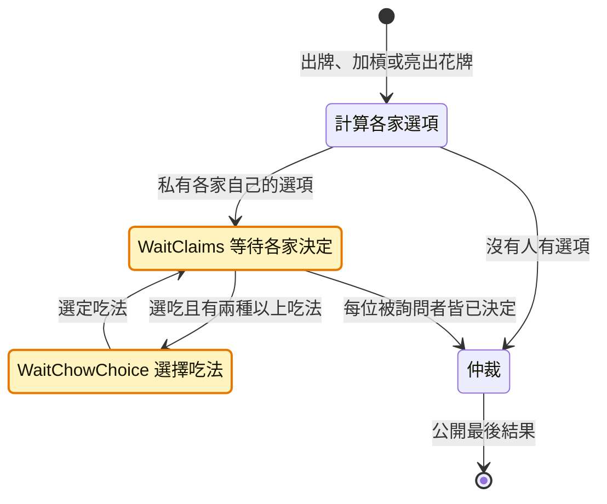
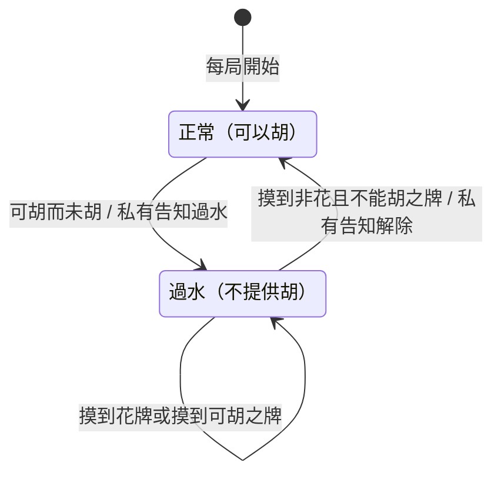

# rules/claim-arbitration Specification

## Purpose

定義 `internal/rules` 宣告視窗狀態機：在出牌、加槓或亮出花牌之後，計算各家合法選項、僅私下詢問有選項的玩家並平行等待不可更改之決定、處理多種吃法選擇、依「胡＞槓＞碰＞吃」與下家優先截胡仲裁並只公開最後結果，同時定義 QKMJ 0.95m 嚴格過水規則。

## Requirements

### Requirement: 三種宣告視窗
系統 SHALL 在三種時機開啟宣告視窗：(1) 出牌後讓其他三家宣告吃、碰、明槓或胡；(2) 加槓時讓其他三家宣告搶槓胡；(3) 亮出花牌後同一家持有 8 張花或 7 張與 1 張分在兩家時，讓持有 8 張或 7 張者宣告八仙過海或七搶一。所有視窗皆依計算選項、等待決定、仲裁與公開結果執行。

#### Scenario: 出牌後開啟宣告視窗
- **WHEN** 2 號座位打出一張牌
- **THEN** 系統僅針對 1、3、4 號座位計算合法選項並進入宣告視窗仲裁

### Requirement: 出牌後的選項計算
出牌後系統 SHALL 計算他家選項：吃（限出牌者下家、數牌且暗手能湊同花色連續三張）；碰（暗手兩張相同）；明槓（暗手三張相同且可摸張數大於 0）；胡（非過水且可組成胡牌型）。可摸張數為 0 時僅計算胡，不提供吃、碰或槓。

#### Scenario: 字牌與非下家不得吃
- **WHEN** 上家打出紅中且自己暗手有兩張紅中，或對家打出三萬且自己暗手有一萬、二萬
- **THEN** 前者僅有碰無吃；後者無吃的選項

### Requirement: 私有詢問與等待所有被詢問者
系統 SHALL 僅私下詢問至少有一個合法選項的玩家，無選項者不被詢問且不知誰正在決定；無人有選項時視窗立即以無宣告結束。所有被詢問者 MUST 平行提交不可更改的決定（「無」亦為決定）後方進行仲裁；重複提交或非被詢問者提交 MUST 被拒絕。

#### Scenario: 一人已決定另一人仍在考慮
- **WHEN** 下家已送出吃，對家仍在考慮是否碰
- **THEN** 系統尚不仲裁，繼續等待對家決定，且已送出之吃決定不得更改

### Requirement: 多種吃法選擇
玩家選擇吃且具兩種以上吃法時，系統 SHALL 讓該座位進入 `WaitChowChoice` 並私下提供所有合法吃法組合，待選定後才視為完成決定；若僅有一種吃法或提交時已指定合法吃法，則直接採納不再二次詢問。

#### Scenario: 兩種吃法進入吃法選擇
- **WHEN** 暗手有二萬、三萬、五萬，上家打出四萬，玩家先選吃而未指定吃法
- **THEN** 系統進入 `WaitChowChoice` 列出二三四萬與三四五萬，待選定後完成決定

#### Scenario: 僅一種吃法直接採納
- **WHEN** 暗手僅二萬、三萬可吃上家四萬，玩家送出吃
- **THEN** 系統直接採用二三四萬完成決定，不進入 `WaitChowChoice`

### Requirement: 優先順序仲裁與截胡
仲裁時系統 SHALL 依「胡＞槓＞碰＞吃」優先順序僅執行最高宣告；全員選「無」則為無宣告。多位玩家同時宣告胡時，系統 SHALL 依觸發者下家起算之輪轉順序（下家→對家→上家）僅選出第一位胡牌，不支援一炮多響。

#### Scenario: 碰蓋過吃與多家胡截胡
- **WHEN** 情況 A：下家宣告吃而對家宣告碰；情況 B：3 號座位出牌，2 號與 4 號同時宣告胡
- **THEN** 情況 A 僅對家碰成立；情況 B 僅 4 號座位胡牌（3 號的下家優先於 2 號）

### Requirement: 搶槓規則
有人宣告加槓時，系統 SHALL 詢問其他三家中非過水且能以該張牌胡牌者是否搶槓（僅胡與無）；有人胡則加槓不成立並以搶槓胡結束、加槓者視同放槍；無人胡則加槓成立。暗槓 MUST NOT 開啟搶槓視窗。

#### Scenario: 加槓被搶與暗槓不可搶
- **WHEN** 2 號座位加槓六索且 4 號聽六索宣告胡；若改為 2 號暗槓六索
- **THEN** 加槓時 4 號搶槓胡成立、2 號視同放槍；暗槓時 4 號不被詢問

### Requirement: QKMJ 0.95m 嚴格過水規則
玩家可胡而未胡（含放槍、搶槓與自摸，不論選無或改選他項）時，系統 SHALL 使該家進入過水並私下通知：過水期間不提供任何胡牌選項（含自摸）。僅當該家後續摸到或補到一張「非花牌且不能胡」的牌時，過水解除並私下通知；花牌宣告不適用過水。

#### Scenario: 放棄放槍或自摸後過水持續至摸到不可胡之非花牌
- **WHEN** 玩家放棄對家點炮進入過水，接著輪到自己摸到一張仍可自摸的牌，再下一輪摸到一張無法胡的牌
- **THEN** 摸到可胡牌時不提供自摸且維持過水；摸到不可胡之非花牌時私下通知過水解除

### Requirement: 花牌宣告視窗
亮出花牌後，若一家持有全部 8 張花，系統 SHALL 詢問該家是否宣告八仙過海（視同自摸）；若一家持有 7 張且另一家持有 1 張，SHALL 詢問持 7 張者是否宣告七搶一（由持 1 張者支付）。放棄時牌局照常進行且同一分布不再重複詢問。

#### Scenario: 七搶一成立與放棄八仙過海
- **WHEN** 1 號已有 7 張花且 3 號亮出第 8 張花，1 號宣告胡；若改為單家集滿 8 張花但選無
- **THEN** 前者由 1 號以七搶一胡牌、3 號支付；後者照常補牌繼續且不再重問

### Requirement: 僅公開最終仲裁結果
宣告視窗仲裁完成後，系統 SHALL 僅公開最終成立之結果（誰、何種宣告、牌組內容或胡牌），所有未成立宣告與他家選項 MUST NOT 公開。

#### Scenario: 吃被碰蓋過不揭露未成立之吃
- **WHEN** 下家宣告吃且對家宣告碰，最終對家碰成立
- **THEN** 公開事件僅包含對家碰牌組，不包含下家曾有吃選項或曾宣告吃
