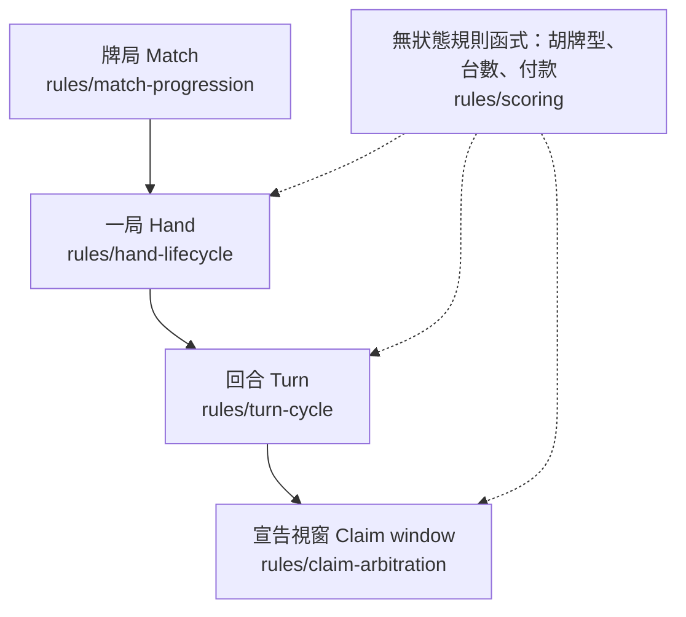

# rules/game-model Specification

## Purpose

定義 `go-qkmj` 規則引擎（`internal/rules`）所有子能力共用的核心詞彙與不變量：144 張麻將牌組成、4 座位固定輪轉順序、注入式亂數牌牆與 16 張保留牌、手牌與牌組張數規則、強型別玩家動作詞彙，以及公開／私有／隱藏資訊的可見性邊界。

## Requirements

### Requirement: 牌的組成與識別
系統 SHALL 使用 144 張牌：萬子、索子、筒子各 1 到 9 每種 4 張（108 張）；東、南、西、北風各 4 張（16 張）；紅中、白板、青發各 4 張（12 張）；春、夏、秋、冬、梅、蘭、菊、竹花牌各 1 張（8 張）。花牌不屬於暗手亦不得組成牌組；所有牌型與花色列舉零值 MUST 代表無效值。

#### Scenario: 洗牌後的牌組總數與分布
- **WHEN** 一局開始建立完整 144 張牌組
- **THEN** 牌牆共 144 張，34 種非花牌各 4 張，8 種花牌各 1 張

#### Scenario: 零值牌型被視為無效
- **WHEN** 呼叫端檢驗零值 `Tile(0)` 是否有效
- **THEN** 系統判定其為無效牌且拒絕納入牌組或手牌

### Requirement: 座位與輪轉順序
牌桌 SHALL 有 4 個固定座位（1 至 4 號），輪轉順序固定為 1→2→3→4→1。某家的下家為輪轉順序下一座，上家為前一座，對家為相隔一座；座位在同一場牌局中不變。每局門風由開門決定，與座位及莊家無關。

#### Scenario: 4 號座位的下家與相對關係
- **WHEN** 查詢 4 號座位的下家、上家與對家
- **THEN** 下家為 1 號座位、上家為 3 號座位、對家為 2 號座位

### Requirement: 牌牆、注入式隨機洗牌與保留牌
每局開始時，系統 SHALL 透過外部注入的 `rand.Source` 將 144 張牌洗成隨機牌牆，MUST NOT 使用全域亂數或系統時間作為種子；未提供有效 `rand.Source` 時 MUST 回傳錯誤。牌牆最後 16 張為保留牌，MUST NOT 被摸走；可摸張數等於剩餘張數減 16，一般摸牌、補花與槓後補牌皆消耗可摸張數。

#### Scenario: 相同種子產生決定性洗牌結果
- **WHEN** 以相同種子的注入 `rand.Source` 分別建立兩副牌牆
- **THEN** 兩副牌牆的發牌與摸牌順序完全一致

#### Scenario: 發完牌後的可摸張數
- **WHEN** 從新牌牆發給 4 家各 16 張、莊家多發 1 張（共 65 張），尚未補花
- **THEN** 可摸張數為 63

#### Scenario: 可摸張數為 0 時禁止繼續摸牌
- **WHEN** 牌牆可摸張數已為 0，再次嘗試摸牌、補花或槓後補牌
- **THEN** 系統回傳牌牆耗盡錯誤，最後 16 張保留牌不被動用

### Requirement: 手牌與牌組張數規則
每位玩家的牌 SHALL 分成暗手與牌組（吃、碰、明槓、加槓、暗槓），計算總張數時每個牌組（含槓）皆算 3 張。非自己回合時暗手加牌組共 16 張；摸牌、吃或碰後為 17 張並須打出一張。吃為同花色連續三張、碰為三張相同、槓為四張相同且須補牌。

#### Scenario: 碰牌後手牌張數為 17
- **WHEN** 玩家碰了他人打出的牌形成一組碰牌組
- **THEN** 暗手加上已公開牌組（每組計 3 張）共 17 張，無須摸牌直接進入出牌

#### Scenario: 暗槓不改變等價牌組張數
- **WHEN** 玩家以暗手四張相同牌宣告暗槓並補一張牌
- **THEN** 該暗槓計為 3 張，連同補進來的牌與剩餘暗手總等價張數仍為 17 張

### Requirement: 強型別玩家動作詞彙
規則引擎接受的玩家輸入 SHALL 僅包含五類強型別動作：摸牌、出牌（指定暗手牌）、自身宣告（無、自摸、暗槓指定牌、加槓指定牌、立直並指定聽牌棄牌、九么九和）、宣告（無、吃並指定吃法、碰、槓、胡）與確認。不在對應等待狀態或非合法選項的動作 MUST 被拒絕且不改變牌局狀態。

#### Scenario: 拒絕不合法的動作輸入
- **WHEN** 玩家在非自身回合送出出牌動作，或立直未指定棄牌、送出非合法選項中的宣告
- **THEN** 規則引擎拒絕該動作並回傳錯誤，牌局狀態維持不變

### Requirement: 公開資訊、私有資訊與隱藏資訊隔離
系統 SHALL 區分三類可見性：公開資訊（圈風、門風、莊家與連莊數、輪到誰、各家暗手張數、出牌紀錄、吃碰明槓加槓、有人暗槓不含牌面、花牌、可摸張數、思考時間、立直/天聽狀態、宣告最終結果、胡牌與各類和局、結算與四圈統計）、私有資訊（本人暗手、摸補牌面、自身選項含可立直棄牌與九么九、過水狀態）及隱藏資訊（牌牆順序、他家暗手、暗槓牌面、他人選項與決定）。隱藏資訊在規則允許前 MUST NOT 揭露（含立直玩家）。

#### Scenario: 牌局進行中暗槓與他人選項不外洩
- **WHEN** 某家宣告暗槓，或多位玩家進入宣告視窗
- **THEN** 其他玩家僅收到有人暗槓之事實或最終仲裁結果，收不到暗槓牌面與他家未成立的宣告選項

#### Scenario: 立直不揭露他家暗手
- **WHEN** 某家宣告立直或天聽
- **THEN** 全桌公開立直/天聽狀態，但不向立直者或他家洩露任何他家暗手與牌牆順序

#### Scenario: 局末亮牌揭露所有暗手與暗槓
- **WHEN** 本局以胡牌或任一種和局結束
- **THEN** 系統向全桌公開四家的暗手與所有暗槓牌面
