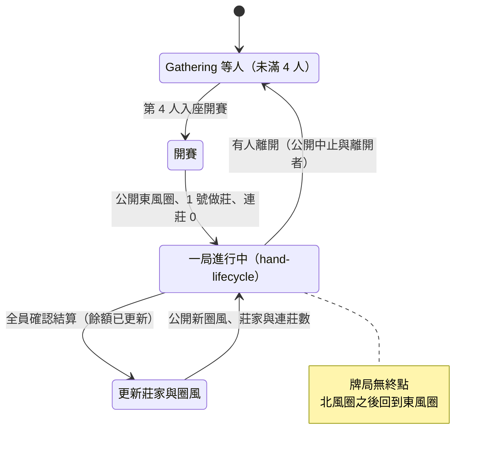
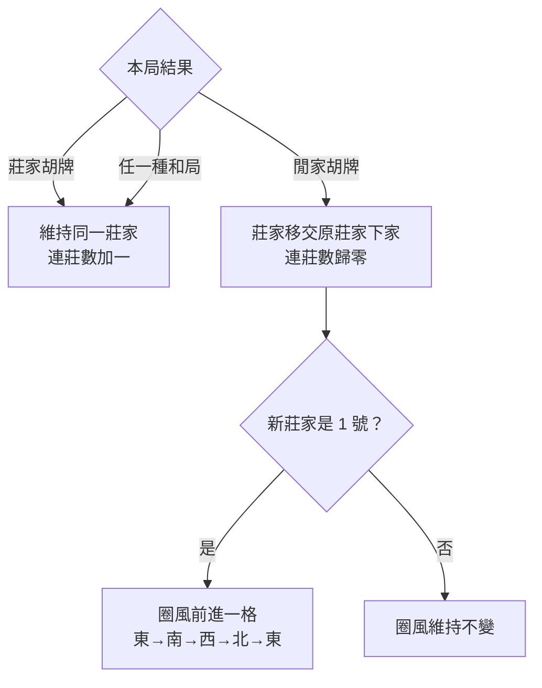

# rules/match-progression Specification

## Purpose

定義 `internal/rules` 外層牌局進程純狀態機（`MatchEngine`）：管理同一桌四位玩家連續多局的開賽初始化、每局結算後即時更新餘額不回溯、全員確認後依 QKMJ 基線規則更新莊家、連莊數與圈風（北風圈後回到東風圈無終點循環），以及有人離桌時作廢本局並回到等人狀態。

## Requirements

### Requirement: 湊滿四人開賽
處於等人狀態並啟動新牌局（湊滿 4 人）時，系統 SHALL 初始化為東風圈、1 號座位做莊、連莊數 0，公開開賽狀態並立即啟動第一局；若已在進行中重複開賽 MUST 回傳錯誤且不改變狀態。

#### Scenario: 湊滿四人自動以東風圈 1 號連莊 0 開賽
- **WHEN** 牌局處於 `Gathering` 狀態且傳入四家初始餘額啟動牌局
- **THEN** 系統公開東風圈、1 號座位做莊、連莊數 0，並立即自動完成第一局洗牌、門風、發牌與開局補花

### Requirement: 局後莊家、連莊與圈風推進
一局以胡牌或任一種和局結束且全員確認後，系統 SHALL 更新牌局進度並公開新狀態後立即開始下一局：莊家胡牌或任一種和局時同一位莊家連莊且連莊數加一；閒家胡牌時莊家移交原莊家順時針下家且連莊數歸零；莊家由 4 號交回 1 號時圈風依東→南→西→北→東前進一格。

#### Scenario: 莊家自摸與流局皆連莊加一
- **WHEN** 東風圈 2 號座位做莊、連莊數 0 時莊家自摸，接著下一局連莊數 1 時海底流局
- **THEN** 自摸後下一局仍由 2 號做莊、連莊數 1；海底流局後下一局仍由 2 號做莊、連莊數 2，圈風皆為東

#### Scenario: 特殊和局同樣維持連莊加一
- **WHEN** 東風圈 2 號座位做莊、連莊數 2 時四風連和並完成全員確認
- **THEN** 下一局仍由 2 號做莊、連莊數 3，圈風維持東

#### Scenario: 閒家胡牌過莊與換圈
- **WHEN** 東風圈 2 號做莊、連莊數 3 時由 3 號胡牌；另於東風圈 4 號做莊時由閒家胡牌
- **THEN** 前者下一局由 3 號做莊、連莊數 0、圈風仍為東；後者下一局由 1 號做莊、連莊數 0、圈風進為南

### Requirement: 無終點循環牌局
北風圈 4 號座位做莊且由閒家胡牌過莊至 1 號座位時，系統 SHALL 將圈風循環回東風圈並繼續新的一局；基線牌局沒有圈數終點，僅因有人離開而結束。

#### Scenario: 北風圈結束回到東風圈繼續
- **WHEN** 北風圈 4 號座位做莊且 2 號座位胡牌，全員確認後
- **THEN** 下一局圈風回到東風圈、1 號座位做莊、連莊數 0，牌局持續進行

### Requirement: 有人離開時本局作廢與重設
牌局進行中（包含摸打階段與局間 `WaitReady`）若任一座位離開，系統 SHALL 立即中止牌局、公開離開座位與中止狀態並回到 `Gathering`；摸打階段中止不亮牌且不結算。之後再次湊滿 4 人開賽時，MUST 從東風圈、1 號座位做莊、連莊數 0 重新開始。

#### Scenario: 一局打到一半有人離開作廢並重設
- **WHEN** 南風圈第 2 局進行中 3 號座位離開，之後再湊滿 4 人重新開賽
- **THEN** 離開當下本局立即作廢不亮牌不結算且回到 `Gathering`；重開時恢復為東風圈、1 號做莊、連莊數 0

### Requirement: 結算即時反映餘額且不回溯
每局胡牌結算完成時，系統 SHALL 在下一局開始之前即把各家金額變動套用至牌局餘額並透過結算事件輸出供外層原子寫入帳戶；之後即使於 `WaitReady` 或後續局中有人離開中止，已完成結算之金額變動 MUST NOT 回溯。

#### Scenario: 結算後於等待確認或下一局有人離開不回溯餘額
- **WHEN** 第 1 局胡牌結算使 1 號 +1500、2 號 -1500，接著於 `WaitReady` 或第 2 局進行中有人離開中止牌局
- **THEN** 第 1 局已結算之餘額變動完整保留不回溯，且第 2 局未完成之進行狀態不產生額外金額變動

### Requirement: 打完四圈統計資料（0.95p）
系統 SHALL 在每一將（東、南、西、北四圈）內累計各座位的輸贏金額、放槍次數、胡牌次數（放槍胡／搶槓／七搶一）、自摸次數（自摸／八仙過海）、已結算局數、和局次數與由外部注入之累計思考時間；每當北風圈 4 號座位過莊回到東風圈 1 號座位完成一將時，公開發出四圈統計事件，隨後歸零統計繼續下一將。

#### Scenario: 打完北風圈回東風圈輸出四圈統計並歸零續打
- **WHEN** 一場牌局打完東、南、西、北四圈，於北風圈 4 號做莊由閒家胡牌且全員確認後
- **THEN** 系統在 `MatchProgressedEvent` 之前公開發出 `RoundCycleCompletedEvent`（含第 1 將四家輸贏、放槍、胡牌、自摸次數與累計耗時），並重設統計繼續第 2 將東風圈
