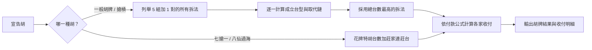

# rules/scoring Specification

## Purpose

定義 `internal/rules` 無狀態計台與結算純函式：5 組加 1 對胡牌型判定、多拆法窮舉與最高總台數選擇、QKMJ 基線全部台型條件與取代關係、各家付款公式與胡牌結果結構。台型顯示名稱沿用 QKMJ 基線用字（例如「杠上開花」「搶杠」「斷麼九」「混全帶麼」「三杠子」）。

## Requirements

### Requirement: 胡牌型判定
系統 SHALL 在暗手與已成立牌組加上胡牌張後，恰好可拆成 5 組牌組加 1 對眼時判定一般胡牌型成立。每組牌組為同花色連續三張（僅限萬、索、筒）、三張相同或一個槓；對子為兩張相同；花牌不計入。七搶一與八仙過海不需一般胡牌型；基線不包含嚦咕嚦咕或立直。

#### Scenario: 一般胡牌型成立
- **WHEN** 玩家有 1 組碰牌、暗手 13 張，加上胡牌張後可組成 4 組加 1 對
- **THEN** 連同既有碰牌共 5 組加 1 對，胡牌型判定為成立

#### Scenario: 字牌不得組成順子
- **WHEN** 暗手中有東風、南風、西風各一張
- **THEN** 這三張不被視為有效順子

### Requirement: 多拆法取最高總台數
同一手牌存在多種 5 組加 1 對拆法時，系統 SHALL 逐一計算每種拆法之成立台型並套用取代規則，採用總台數最高之拆法作為最終胡牌結果。

#### Scenario: 同牌可拆為三刻或三順時取最高台
- **WHEN** 暗手含一萬、二萬、三萬各三張，既可拆成三個刻子亦可拆成三組一二三萬順子
- **THEN** 系統分別計台並採用總台數較高之拆法與其台型清單

### Requirement: 基本台型
系統 SHALL 依下表計算基本台型；暗槓不影響門清判定。

| 台型 | 台數 | 條件 |
|---|---|---|
| 莊家 | 1 | 胡牌者是莊家 |
| 連Ｎ拉Ｎ | 2×N | 胡牌者是莊家且連莊數為 N（N ≥ 1） |
| 門清 | 1 | 沒有吃、碰、明槓、加槓（暗槓不影響） |
| 自摸 | 1 | 胡自己摸到的牌 |
| 門清自摸 | 3 | 門清且自摸；取代門清與自摸 |

#### Scenario: 暗槓後門清自摸
- **WHEN** 僅有 1 組暗槓且無其他明副露的閒家自摸
- **THEN** 計「門清自摸 3 台」，不另計門清與自摸

#### Scenario: 莊家連莊胡別人打出的牌
- **WHEN** 門清且連莊數為 2 的莊家胡他人打出的牌
- **THEN** 基本台計「莊家 1 台」、「連２拉２ 4 台」與「門清 1 台」

### Requirement: 情境台型
系統 SHALL 依下表計算情境台型；天胡、地胡、人胡與天聽的第一輪條件在場上任一家吃、碰或槓後即失效，天聽取代立直。

| 台型 | 台數 | 條件 |
|---|---|---|
| 立直 | 1 | 門清狀態下宣告立直後胡牌 |
| 杠上開花 | 1 | 自摸的那張牌為槓後或補花後補進 |
| 海底摸月 | 1 | 自摸最後一張可摸的牌 |
| 河底撈魚 | 1 | 可摸張數為 0 時胡他人打出的牌 |
| 搶杠 | 1 | 搶他人加槓胡牌 |
| 全求人 | 2 | 暗手僅剩一張，胡他人打出的牌 |
| 天聽 | 8 | 第一輪未中斷時門清宣告立直後胡牌；取代立直 |
| 天胡 | 16 | 莊家第一手直接自摸 |
| 地胡 | 16 | 閒家第一輪首次摸牌即自摸 |
| 人胡 | 16 | 閒家第一輪首次出牌前胡他人牌 |

#### Scenario: 一般立直與天聽取代立直
- **WHEN** 情況 A：玩家中盤門清立直後胡他人打出的牌；情況 B：玩家第一輪未中斷即門清立直後自摸
- **THEN** 情況 A 計「立直 1 台」與「門清 1 台」；情況 B 計「天聽 8 台」與「門清自摸 3 台」，不另計「立直 1 台」

#### Scenario: 補花後自摸計杠上開花
- **WHEN** 玩家摸到花牌並補進一張牌直接自摸
- **THEN** 情境台計「杠上開花 1 台」

#### Scenario: 天胡同時疊加莊家與門清自摸
- **WHEN** 莊家開局第一手 17 張直接自摸（無連莊、無其他花色牌型台）
- **THEN** 計「天胡 16 台」、「莊家 1 台」、「門清自摸 3 台」，共 20 台

#### Scenario: 第一輪有人碰牌後不計地胡
- **WHEN** 第一輪中有人碰牌，其後尚未出牌的閒家首次摸牌自摸
- **THEN** 不計地胡

### Requirement: 風牌台型
系統 SHALL 依下表計算風牌台型並套用取代規則。

| 台型 | 台數 | 條件 |
|---|---|---|
| 東風、南風、西風、北風 | 1 | 該風刻子或槓，且為圈風或本人門風 |
| 東風東、南風南、西風西、北風北 | 2 | 該風同時為圈風與門風；取代上一行 |
| 小四喜 | 8 | 三種風刻子或槓加第四種風一對；取代上兩行 |
| 大四喜 | 16 | 四種風皆為刻子或槓；取代上三行 |

#### Scenario: 北風圈且門風為北的北風刻子
- **WHEN** 北風圈、門風為北的玩家胡牌且有北風刻子
- **THEN** 計「北風北 2 台」，不另計「北風」

### Requirement: 三元牌與字一色
系統 SHALL 依下表計算三元牌與字一色台型並套用取代規則。

| 台型 | 台數 | 條件 |
|---|---|---|
| 紅中、白板、青發 | 1 | 該三元牌刻子或槓，各自計台 |
| 小三元 | 4 | 兩種三元牌刻子或槓加第三種一對；取代上一行 |
| 大三元 | 8 | 三種三元牌皆為刻子或槓；取代小三元與第一行 |
| 字一色 | 8 | 全部為風牌與三元牌；取代碰碰胡 |

#### Scenario: 碰出牌組的字一色
- **WHEN** 玩家碰出東風與南風，其餘暗手皆為風牌與三元牌並胡白板
- **THEN** 正確計入「字一色 8 台」並取代碰碰胡，同時保留適用之三元與風牌台

### Requirement: 花牌台型
系統 SHALL 依下表計算花牌台型；七搶一與八仙過海僅另加適用的莊家與連Ｎ拉Ｎ，不計其他台型。

| 台型 | 台數 | 條件 |
|---|---|---|
| 花牌 | 每張 1 | 對應門風之花：東春梅、南夏蘭、西秋菊、北冬竹 |
| 春夏秋冬 | 2 | 集齊春夏秋冬；取代其中之花牌台 |
| 梅蘭菊竹 | 2 | 集齊梅蘭菊竹；取代其中之花牌台 |
| 七搶一 | 8 | 宣告七搶一成立 |
| 八仙過海 | 16 | 宣告八仙過海成立 |

#### Scenario: 集滿八張花但放棄八仙過海後一般胡牌
- **WHEN** 玩家持有全部 8 張花牌但以一般胡牌型胡牌
- **THEN** 花牌部分計「春夏秋冬 2 台」與「梅蘭菊竹 2 台」，取代個別正花台並與手牌台型累加

#### Scenario: 莊家連莊宣告八仙過海
- **WHEN** 連莊數為 1 的莊家宣告八仙過海
- **THEN** 計「八仙過海 16 台」、「莊家 1 台」、「連１拉１ 2 台」，共 19 台，不計手牌其他台型

### Requirement: 順子類台型
系統 SHALL 依下表計算順子類台型。

| 台型 | 台數 | 條件 |
|---|---|---|
| 平胡 | 2 | 無花牌；五組皆順子；眼非字牌；非自摸；胡張非眼且為兩面聽 |
| 一杯口 | 1 | 門清且有兩組完全相同的順子 |
| 二杯口 | 2 | 門清且有兩對完全相同的順子；取代一杯口 |
| 三色同順 | 2 | 萬索筒皆有同數字順子；非門清 1 台 |
| 一條龍 | 2 | 同花色具 123、456、789 順子；非門清 1 台 |
| 斷麼九 | 1 | 全手無一、九與字牌 |

#### Scenario: 兩面聽與邊張中洞的平胡區分
- **WHEN** 無花牌、五順子且非字牌眼的玩家胡他人打出的牌：情況 A 以二三索聽一四索胡四索；情況 B 以一二索邊張聽三索胡三索
- **THEN** 情況 A 計「平胡 2 台」；情況 B 非兩面聽不計平胡

#### Scenario: 非門清一條龍減台
- **WHEN** 玩家吃四五六萬並湊齊一二三、四五六、七八九萬
- **THEN** 計「一條龍 1 台」

### Requirement: 刻子與槓台型
系統 SHALL 依下表計算刻子與槓台型。暗刻指暗手自行湊成的刻子與暗槓，靠他人打出牌才湊成的刻子不算暗刻。

| 台型 | 台數 | 條件 |
|---|---|---|
| 碰碰胡 | 4 | 五組皆為刻子或槓 |
| 三暗刻、四暗刻、五暗刻 | 2、6、8 | 暗刻 3、4、5 組；五暗刻取代碰碰胡 |
| 三杠子、四杠子 | 2、6 | 明槓、暗槓或加槓共 3、4 組 |
| 三色同刻 | 2 | 萬索筒皆有同數字之刻子或槓；非門清 1 台 |

#### Scenario: 門清與非門清三色同刻台數區分
- **WHEN** 情況 A：門清湊齊三萬、三索、三筒刻子；情況 B：碰出三萬後湊齊三索、三筒刻子（A19）
- **THEN** 情況 A 計「三色同刻 2 台」；情況 B 計「三色同刻 1 台」

#### Scenario: 胡他人牌湊順子不扣同牌種暗刻
- **WHEN** 暗手已有四組刻子（含三張七索）及五索、六索，胡他人打出的七索湊成五六七索
- **THEN** 七索暗刻仍計為暗刻，計「四暗刻 6 台」

#### Scenario: 胡他人牌湊成刻子不算暗刻
- **WHEN** 暗手已有兩組暗刻與一對九筒，胡他人打出的九筒湊成第三組刻子
- **THEN** 九筒刻子不算暗刻，僅有 2 個暗刻，不計三暗刻

### Requirement: 花色與么九台型
系統 SHALL 依下表計算花色與么九台型並套用取代規則。

| 台型 | 台數 | 條件 |
|---|---|---|
| 混一色 | 4 | 僅一種數字花色加字牌 |
| 清一色 | 8 | 僅一種數字花色；取代混一色 |
| 混全帶麼 | 2 | 每組與眼皆含一、九或字牌且含數字組；非門清 1 台 |
| 純全帶麼 | 4 | 每組與眼皆含一或九且無字牌；取代混全帶麼 |
| 混老頭 | 4 | 全為一、九與字牌且含一或九；取代混全帶麼與碰碰胡 |
| 清老頭 | 8 | 全為一與九；取代碰碰胡、純全帶麼與混老頭 |

#### Scenario: 碰出字牌的混老頭
- **WHEN** 玩家碰出一萬與南風，其餘全為一、九與字牌並胡牌
- **THEN** 計「混老頭 4 台」，並取代混全帶麼與碰碰胡

### Requirement: 付款公式與胡牌結果
系統 SHALL 依公式計算每位支付者應付金額：`底 + 應計台數 × 每台`，其中支付者為莊家時應計台數為 `總台數 + 1 + 連莊數 × 2`（預設底 500、每台 200）。自摸與八仙過海由其餘三家各付；胡他人牌由出牌者付；搶槓由加槓者付；七搶一由持有 1 張花者付。胡牌結果 MUST 包含胡牌者、自摸或支付者、各成立台型名稱與台數、總台數、莊家加台資訊與四家金額變動明細。

#### Scenario: 閒家自摸時莊家另加莊家與連莊台
- **WHEN** 閒家自摸總台數 5 台，莊家連莊數 1，底 500、每台 200
- **THEN** 莊家付 `500 + (5 + 1 + 2) × 200 = 2100`，其餘兩家各付 `500 + 5 × 200 = 1500`，胡牌者實收 `5100`

#### Scenario: 閒家胡莊家放槍時標註莊家加台
- **WHEN** 閒家胡連莊數為 0 的莊家打出的牌，手牌總台數 3 台
- **THEN** 胡牌結果列出各台型與總台數 3 台、標註莊家支付加 1 台（以 4 台計），莊家付 `500 + 4 × 200 = 1300`
