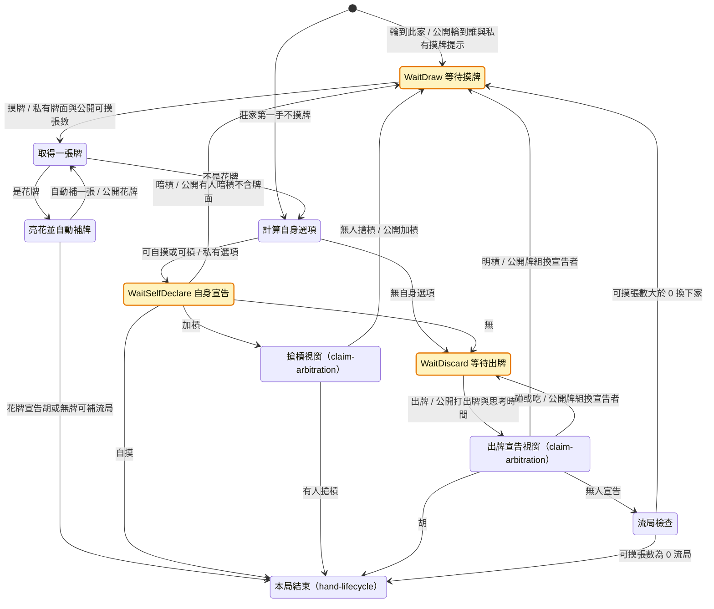

# rules/turn-cycle Specification

## Purpose

定義 `internal/rules` 單局內的回合狀態機：等待摸牌、摸牌與自動補花、全手自身選項（自摸、暗槓、加槓）、搶槓轉移、等待出牌、宣告結果座位轉移、可摸張數為 0 僅能胡與海底流局，以及由外部注入耗時之累計思考時間。

## Requirements

### Requirement: 等待摸牌與槓後手動補牌
輪到某家摸牌（上一家出牌無人宣告，或該家剛完成暗槓、明槓、加槓須補牌）時，系統 SHALL 公開輪到誰、私下提示該家摸牌並進入 `WaitDraw`，僅接受該家送出摸牌動作。

#### Scenario: 暗槓後進入等待摸牌補牌
- **WHEN** 玩家在自己回合完成暗槓
- **THEN** 系統不自動發補牌，而是讓該家進入 `WaitDraw` 等待送出摸牌，且補進之牌標記為補牌供杠上開花判定

### Requirement: 摸牌與自動連續補花
該家送出摸牌後，系統 SHALL 自可摸牌牆取一張牌私下交付該家，並公開誰摸牌與新可摸張數。摸到或補到花牌時，系統 SHALL 公開亮出花牌、先檢查花牌宣告視窗（8 張或 7+1），無人宣告後自動補一張牌直到補到非花牌；若此時可摸張數已為 0 無法補牌，SHALL 直接以流局結束，絕不動用 16 張保留牌。

#### Scenario: 摸到連續花牌自動補花
- **WHEN** 玩家摸到梅１後自動補到竹４，再自動補到五萬
- **THEN** 梅１與竹４依序公開亮出，五萬私下交付該家，可摸張數共減少 3 張

#### Scenario: 最後一張可摸牌為花牌時保護保留牌
- **WHEN** 可摸張數為 1，玩家摸到最後一張牌為花牌且無人宣告花牌胡
- **THEN** 系統公開亮花後因可摸張數已為 0 不動用保留牌，本局直接以流局結束

### Requirement: 全手計算自身選項與自身宣告
摸到或補到非花牌後（以及莊家第一手時），系統 SHALL 掃描整個暗手與既有碰牌計算自身選項：自摸（非過水且胡牌型成立）、暗槓、加槓、立直（未立直、門清、可摸張數 > 0 且存在聽牌棄牌）與九么九和（第一輪未中斷且暗手含 >= 9 種么九牌）。可摸張數為 0、已立直或場上已有兩家以上累計 4 槓時不提供槓。有選項時私下告知並進入 `WaitSelfDeclare`，否則進入 `WaitDiscard`。

#### Scenario: 暗手既有四張或留存碰牌第四張皆可槓
- **WHEN** 非立直玩家暗手早有四張五萬或留有已碰白板之第四張，本回合摸到二索且未達四槓和上限
- **THEN** 自身選項包含暗槓五萬或加槓白板，不限於剛摸進之二索

#### Scenario: 槓後補牌可連續槓
- **WHEN** 玩家暗槓後於 `WaitDraw` 補進一張牌，使暗手又湊成另一組暗槓或加槓且未達兩家四槓上限
- **THEN** 系統再次進入 `WaitSelfDeclare` 允許連續槓

### Requirement: 等待出牌與宣告結果轉移
在 `WaitDiscard` 系統 SHALL 僅接受該家打出暗手（含剛摸牌）中的一張非花牌（若該家已立直，MUST 僅接受打出剛摸進或補進之牌，否則拒絕）；公開打出牌、更新出牌紀錄與思考時間後開啟出牌宣告視窗。依仲裁結果：胡則結束、一炮三響則和局、明槓則換宣告者進 `WaitDraw`、碰吃則換宣告者進 `WaitDiscard`；無人宣告則依序檢查四風連和、四槓和與海底流局。

#### Scenario: 對家碰牌跳過中間座位並移走牌河該牌
- **WHEN** 1 號打出三筒，3 號碰三筒後打出九萬且無人宣告
- **THEN** 三筒自牌河移入 3 號牌組，3 號直接出牌不摸牌，其後輪到 4 號摸牌而跳過 2 號

### Requirement: 可摸張數為 0 僅能胡與海底流局
可摸張數為 0 時，系統 SHALL 禁止暗槓、加槓以及出牌後的吃、碰、明槓，僅允許自摸（海底摸月）或胡最後打出之牌（河底撈魚）。若可摸張數為 0 且出牌後無人宣告胡，系統 SHALL 立即以海底流局結束本局。

#### Scenario: 最後一張打出僅問胡不問碰且無人胡即流局
- **WHEN** 可摸張數為 0，玩家打出一張下家有一對但不能胡的牌
- **THEN** 系統不詢問下家碰牌，本局立即以流局結束

### Requirement: 注入式累計思考時間
系統 SHALL 維護各家本局累計思考時間（每局開始歸零），於出牌動作傳入由外部計算之思考耗時後累加並隨出牌事件公開；規則引擎內部 MUST NOT 讀取系統時鐘。

#### Scenario: 出牌累加並公開思考時間
- **WHEN** 2 號座位本局已累計 5 秒，本次出牌傳入思考耗時 12 秒
- **THEN** 2 號座位公開的累計思考時間更新為 17 秒，規則引擎本身未存取系統時間

### Requirement: 四風連和
開局第一輪無人吃、碰或槓的狀況下，自莊家起四家依序打出的前 4 張牌若為完全相同之風牌（例如皆為東風），且第 4 張牌無人宣告胡牌時，系統 SHALL 立即以四風連和（`HandEndFourWinds`）結束本局；若第 4 張牌有人胡牌則以胡牌優先。

#### Scenario: 四家連續打出東風且無人胡牌即四風連和
- **WHEN** 莊家與其餘三家開局連續各打出一張東風，中途無人吃碰槓且第 4 張東風無人胡牌
- **THEN** 本局立即以 `HandEndFourWinds` 和局結束

#### Scenario: 第 4 張同風被胡牌時胡牌優先
- **WHEN** 前三家皆打出東風，第 4 家打出東風時有人宣告胡牌
- **THEN** 胡牌優先成立，不觸發四風連和

### Requirement: 四槓和
一局中若由兩家以上累計完成 4 組槓（明槓、暗槓或加槓），系統 SHALL 在第 4 槓成立者補牌並打出一張牌且無人胡牌（亦未被自摸或搶槓）時，立即以四槓和（`HandEndFourKongs`）結束本局；若 4 組槓皆由同一家獨立完成，MUST NOT 觸發四槓和（維持四杠子牌局）。

#### Scenario: 兩家以上累計四槓於安全棄牌後成立四槓和
- **WHEN** 1 號已有 2 槓、2 號已有 1 槓，3 號再完成第 4 槓並補牌打出無人胡之牌
- **THEN** 本局立即以 `HandEndFourKongs` 和局結束

#### Scenario: 單家獨攬四槓不觸發四槓和
- **WHEN** 1 號獨自完成 4 組槓並補牌打出一張無人胡之牌
- **THEN** 牌局照常進行，不觸發四槓和

### Requirement: 九么九和
莊家第一手或各閒家第一輪首次摸牌（期間場上未曾有任一家吃、碰或槓）時，若該家暗手包含 9 種以上不同的一九數牌或字牌，系統 SHALL 於自身選項提供九么九和；玩家可選擇宣告以 `HandEndNineTerminals` 立即結束本局，亦可放棄繼續打牌。

#### Scenario: 九種么九牌宣告九么九和
- **WHEN** 閒家第一輪未中斷時首次摸牌後，暗手含一萬、九萬、一索、九索、一筒、九筒、東風、南風、紅中共 9 種么九牌並宣告九么九和
- **THEN** 本局立即以 `HandEndNineTerminals` 和局結束

#### Scenario: 同種么九牌重複不重複計種數
- **WHEN** 暗手僅有 8 種么九牌但其中東風有 3 張（共 10 張么九牌）
- **THEN** 不足 9 種不同么九牌，不提供九么九和選項

### Requirement: 立直與天聽（公平版）
未立直且門清之玩家於自身回合（可摸張數 > 0）若暗手存在打出後即構成聽牌的牌，系統 SHALL 私有提供可立直棄牌清單。玩家以單一動作宣告立直並指定其中一張棄牌後，系統公開立直狀態（第一輪未中斷標記天聽）、立即打出該牌並鎖定其手牌：立直後禁止吃、碰、暗槓、加槓，且後續每次摸到非花牌若未自摸 MUST 僅能打出該張剛摸進之牌；立直 MUST NOT 揭露他家暗手。

#### Scenario: 門清聽牌宣告立直後鎖定摸切且不揭露他家暗手
- **WHEN** 門清玩家於自身回合宣告立直並打出指定聽牌棄牌，下一輪摸到非胡牌五索後嘗試改打手中原本之一萬
- **THEN** 宣告立直當下公開立直事件且無他家暗手事件；後續嘗試改打一萬遭拒絕，僅允許打出剛摸進之五索

#### Scenario: 第一輪未中斷立直標記天聽
- **WHEN** 閒家於第一輪場上無人吃碰槓時首次摸牌即宣告立直，隨後胡牌
- **THEN** 公開立直事件標記 `IsTianTing=true`，胡牌計入「天聽 8 台」且不另計立直 1 台
